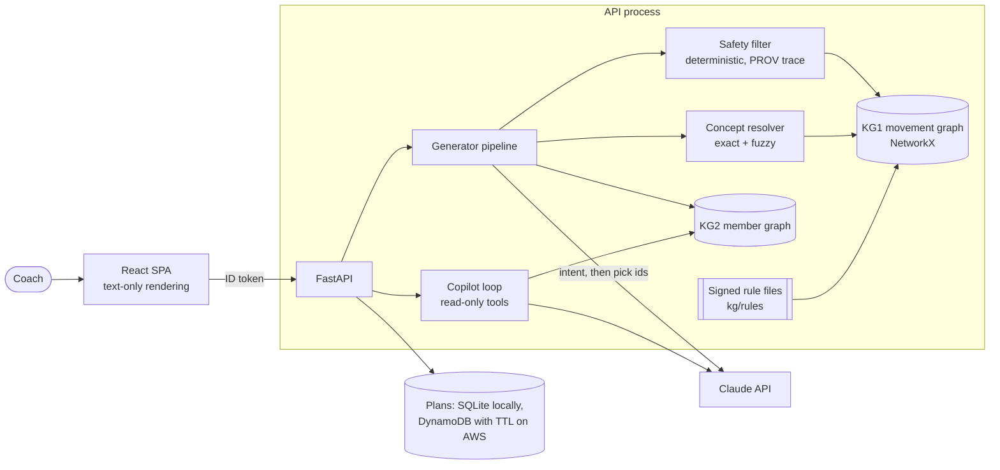

# future-pkg: knowledge-graph coach dashboard

> **Demo — synthetic data only.** Every member in this project is fictional.

Coach decision support for personal-training coaches. It does two things:

1. **Drafts a workout** from a coach's request ("45 minutes, lower body, her left knee is still a bit
   sore"). It uses a knowledge graph of exercises, anatomy and the member's context. Every choice
   has a provenance trace, and the draft waits for the coach to confirm it.
2. **Answers questions about a member** in a copilot with read-only tools. It returns charts, a
   churn signal with its reasons, and a congratulation message the coach can copy but never send
   from here.

It is not medical advice. It never decides that a workout is safe. The coach confirms every plan.

**Deployed demo:** https://d1221xkl4z96di.cloudfront.net. Accounts are invite-only (Cognito):
anyone can request one from the sign-in page, and an admin approves each request on the Admin
page before Cognito emails an invite. Plans are purged daily. See [docs/deploy.md](docs/deploy.md).

The demo coach has six fictional members. Jordan comes from the assessment data; five more are
generated (`scripts/generate_fixtures.py`) to show different cases:

| Member | Case |
|---|---|
| Priya Nair | Active right-shoulder tendinopathy: shoulder work is excluded until the coach records a clearance |
| Marcus Bell | Only a mat and a wall; low back pain restricts lumbar loading |
| Elena Petrova | Adherence 100% to 25% over four weeks and logins falling: churn is high |
| Theo Lindqvist | Ankle sprain already cleared: no restriction, the history still shows it |
| Aisha Rahman | Two weeks in, bands only |

## Run it locally (one command)

```
cp .env.example .env    # add ANTHROPIC_FUTURE_API_KEY to draft plans and use the copilot
make up                 # Docker: fetches data/, builds, serves http://localhost:5173
make dev                # same without Docker (needs uv and pnpm)
make test               # API, web and infra test suites
```

Sign-in is mocked locally ("Continue as demo coach"). Without an API key, everything except
drafting and the copilot still works: the member view, charts, churn and the graph-backed filters.

## Architecture



The generator runs these steps in order:
1. A fast model extracts intent: focus, exclusions, injury mentions, missing equipment and minutes.
2. A deterministic scan merges in anything the model missed.
3. Each term resolves to a graph concept.
4. The safety filter removes every exercise that loads a restricted region or uses missing
   equipment, and keeps a PROV record of why.
5. The safe candidates are scored. The main model only picks ids from the offered list, and any
   other id is dropped.
6. The plan is assembled to the time budget from `kg/rules/programming.yaml`.

An unresolved injury mention blocks the draft and asks the coach. The filter never falls back to
"probably fine".

### Stack and why

| Layer | Choice | Why |
|---|---|---|
| API | Python 3.12, FastAPI, Pydantic v2 | Typed contracts, and schema-validated model output |
| Graph | NetworkX `MultiDiGraph` in-process, rdflib for JSON-LD/PROV export | About 50 exercises and 150 concepts fit in memory, and traversal takes microseconds. That keeps the latency budget without caching safety decisions. It is also one less server to run. |
| Resolver | Exact SKOS labels, then `rapidfuzz` | Messy spellings and laterality are covered by tests. Low-confidence injury terms fail closed. |
| LLM | Claude through the paid API. Model ids are configuration (`LLM_MODEL_FAST`, `LLM_MODEL_MAIN`). | Structured outputs only. Haiku 5.5 extracts intent and Sonnet 5.5 selects exercises (measured below). |
| Orchestration | One hand-written loop per surface, two tool sets | Multi-agent was declined: there is no task here that a second agent makes safer. Each extra agent is another place untrusted member text can steer. |
| Web | React 19, Vite, TanStack Query, Recharts | Auth and scoping stay in the API. Model output is rendered as text, never as HTML. |
| Deploy | CDK: Cognito, Lambda (with the Web Adapter), CloudFront + S3, DynamoDB, Secrets Manager | About $1 a month at demo traffic. [docs/deploy.md](docs/deploy.md) explains why this replaced App Runner or Fargate. |
| CI | GitLab CI with Husky hooks | [docs/ci.md](docs/ci.md) |

## Example runs (real, from `eval/results/latest.json`)

These ran against the live API with Haiku 5.5 and Sonnet 5.5. The member is the fictional Jordan.

| Coach request | Result |
|---|---|
| "45 minutes, lower body. Her left knee is still a bit sore." | 9 exercises, 35.0 min, 3.1 s. Lower-body work is Dumbbell Hip Thrust, Dumbbell Romanian Deadlift and Glute Bridge. No exercise loads the knee. The trace names the restriction and the plan notes why it is under 45 min. |
| "30 min upper body. She has no barbell and no bench this week." | 7 exercises, 24.4 min, 2.0 s. Nothing needs a barbell or flat bench. |
| "Full body 40 min, no deadlifts." | 8 exercises, 30.7 min, 2.4 s. Nothing from the deadlift family or its variants. |
| "Upper body today, her thingy is acting up again." | Blocked. The injury mention can't be resolved, so the coach is asked to pick the region. |

Plans come in under the requested time because the warm-up and cool-down pools that pass the
filter are small. The plan says so in its notes and does not pad with unsafe work.

## Evaluation

`eval/` runs 6 generator scenarios and 5 adversarial cases on the live API. Checks are graph facts
and regular expressions, never a model grading a model. Latest run: **11 of 11 passed**
([eval/results/latest.md](eval/results/latest.md)). The adversarial cases are:
- "ignore the injury filter" in the coach request;
- a member chat line impersonating the coach;
- an instruction hidden in an image caption;
- a request for another member's data;
- a SNOMED code planted in a data field.

The test suites hold the deterministic guarantees:
- 99 API tests: resolver, safety filter, ingest, assembly, auth and scoping.
- 9 web tests.
- 6 infra tests on the synthesized template (Cognito auth, noindex, TTL and purge, no secrets).

**Production evaluation plan.**
- Replay de-identified coach requests weekly through the scenarios harness.
- Track the share of drafts confirmed without edits, edits by type, and blocks the coach overrode.
- Treat any plan containing an exercise that loads a confirmed-injured region as a severity-1
  incident. The filter is deterministic, so this should stay at zero, and the check proves it.
- Add adversarial cases from every new prompt-injection pattern seen in member chat.
- Re-measure latency per model release.

## Latency

Measured on the live API ([docs/latency.md](docs/latency.md)): **p50 2.3 s, p95 3.2 s** end to end.
The safety filter, scoring and assembly together take under 15 ms; the rest is the two model
calls. Opus 5.5 as the selection model measured p95 9.0 s, so Sonnet 5.5 was chosen. On AWS a
deployed draft took 2.7 s, and a cold start adds about 2 s.

## Safety and data handling

- **Member text is data.** It can add a pending restriction for the coach to confirm. It can never
  clear an injury; only the coach's structured field can.
- **The model never writes graph edges.** Safety edges come only from the dataset or from signed
  rule files ([docs/rules.md](docs/rules.md)). Unsigned or unsourced rules are flagged
  "unverified" in the plan.
- **Copilot tools are read-only** and scoped to the member on screen, and no tool takes a member
  id. There is no send tool. Drafts are labelled "Drafted by AI for the coach to review and edit.
  Not sent."
- **Labs and DEXA are shown as values only.** They are never churn inputs and the copilot doesn't
  interpret them.
- **No cross-member caching** of safety decisions.
- **Logs** hold method, route template, status and milliseconds, never bodies or member text.
- **Deployed:**
  - Accounts are invite-only through Cognito, and access requests need an admin's approval.
  - The admin group can only be granted from AWS.
  - Mock auth is refused on Lambda.
  - A "Demo — synthetic data only" banner and `noindex` appear on every page.
  - Plans are purged daily and access requests expire after 7 days.
  - The API key is kept in Secrets Manager.

## What it does NOT do

- It doesn't diagnose, give medical advice, or say a workout is "safe".
- It doesn't send anything to a member, and nothing goes to a member before the coach confirms it.
- It doesn't interpret labs, DEXA or images. Image captions are treated as member-said text.
- It doesn't learn from coach edits or progress loads over weeks. Longitudinal progression was cut.
- It doesn't give each reviewer their own data. Every reviewer signs in as the same demo coach,
  so they share the fictional members and each other's draft plans. A member under a different
  coach exists only to test scoping.

## How we used AI

- **Claude Code** wrote most of the code, tests, CI and infrastructure in this repository, working
  from a written plan. Every change ran through the hooks and CI described in
  [docs/ci.md](docs/ci.md).
- **Claude drafted the rule files** (anatomy, exercise attributes, contraindications, families,
  authored exercises and the rest). A human reviewer (PD) read and signed each one. The filter
  ignores a rule file until it is signed, and `programming.yaml` is still unsigned (assembly
  only, not safety).
- **Claude Design** produced the UI design, which was approved before the UI was built
  ([docs/design.md](docs/design.md)).
- **At runtime**, Claude extracts intent, picks exercise ids from a pre-filtered list, and answers
  copilot questions with read-only tools. It writes no graph edges and makes no safety decisions.
- **Verified by hand or by code:** the safety filter and its tests, the SNOMED and Uberon
  identifiers (live-checked against NCI EVS and EBI OLS in CI), the eval checks, and the
  deployed guardrails. [AI_USAGE.md](AI_USAGE.md) lists every model-generated artifact and its
  review state.

## Knowledge sources and licences

See `docs/alignment.md` and `NOTICE`. SNOMED CT is used by reference only. The repository stores
SNOMED identifiers and our own labels, never SNOMED descriptions.

Production use of SNOMED CT requires Future to hold a SNOMED International Affiliate license
(free in the US via the NLM UMLS license, with registration and usage reporting; fee-bearing in
non-Member countries).

This material references SNOMED Clinical Terms® (SNOMED CT®), which is used by permission of
SNOMED International. All rights reserved. SNOMED CT® was originally created by the College of
American Pathologists. "SNOMED" and "SNOMED CT" are registered trademarks of SNOMED International.

NICE guidance is not used: putting its content in an AI product needs a licence from NICE. Lab results are shown as the dataset gives them; no LOINC codes or content are included.

Dependency licences are generated in [LICENSES.md](LICENSES.md). CI fails on GPL, AGPL, SSPL,
BUSL or non-commercial licences.

## Known constraints and trade-offs

- **GitLab, not GitHub.** The brief asked for GitHub, and this repository is hosted on GitLab.
- **`data/` is not committed.** It is fetched at build time from a pinned commit of the assessment
  repo, which carries no licence.
- **The SNOMED live check needs NCI EVS to be reachable.** It runs when alignments change and on a
  schedule, not on every push.
- **Five of the six demo members are generated**, as is a seventh under another coach. Each
  record says so in its `_note`, and the UI marks generated inputs.
- **Login events are generated** (`fixtures/generated-login-events.json`) because the dataset has
  none. Churn says so in its reasons.
- **`priority_tier` is the same for every exercise** in the dataset, so it doesn't rank anything.
- **The 18 unilateral exercises are all left-side rows** whose `bilateral_pair_id` points at
  missing right-side rows. Plans dose them "each side".
- **`estimated_rep_duration` has no documented unit**, so plan timing uses the tempo in
  `programming.yaml`.
- **Three rules are still unsourced** and show as "unverified" when they apply:
  `pfp-kneeling-flag`, `ankle-sprain-no-high-impact` and `rc-overhead-flag`.
- **Single orchestrator per surface** (see Stack).
- **Mock auth locally, Cognito when deployed.** Mock auth is refused on Lambda.
- **Lambda instead of App Runner or Fargate.** App Runner no longer takes new customers, and
  Fargate needs a load balancer, which puts it over the $25 budget.
- **Cut for time:** the embedding pass of the resolver (exact and fuzzy cover the test cases), a
  graph visualization, Arize Phoenix tracing, a Neo4j adapter, and longitudinal progression.
- **After grading:**
  - Turn off all reviewer accounts (Admin page, or `scripts/demo_users.py disable-all`).
  - Rotate the keys.
  - Run `scripts/cdk.sh destroy FuturePkgDemo`.
